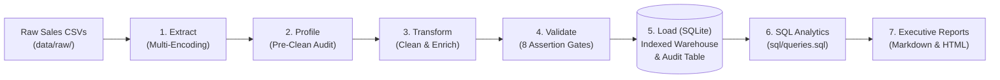

# 🚀 Sales Data ETL Pipeline (v2.0)

[](https://www.python.org/)
[%20%7C%20MySQL%20%26%20Postgres-green.svg)](https://www.sqlalchemy.org/)
[-brightgreen.svg)](tests/)
[](#data-quality-scorecard)
[](#cross-platform-compatibility)
[](LICENSE)

An enterprise-grade, modular, and resilient **Extract-Transform-Load (ETL)** data pipeline built in Python and SQL. Ingests messy, heterogeneous retail sales exports, executes pre-cleaning data profiling, applies strict business validation rules, persists normalized transactions into an indexed database (**SQLite** by default with zero setup; fully compatible with **MySQL** and **PostgreSQL** via SQLAlchemy), executes analytical SQL queries, and generates automated executive reports.

---

## 📑 Table of Contents
1. [Architecture Overview](#-architecture-overview)
2. [What's New in v2.0](#-whats-new-in-v20-major-upgrade)
3. [Quick Start in 60 Seconds](#-quick-start-in-60-seconds)
4. [Project Structure](#-project-structure)
5. [Complete Documentation Suite](#-complete-documentation-suite)
6. [Pipeline Execution & CLI](#-pipeline-execution--cli)
7. [Automated Testing Suite](#-automated-testing-suite)
8. [Data Quality & Lineage](#-data-quality--lineage)
9. [SQL Analytics & Executive KPIs](#-sql-analytics--executive-kpis)
10. [Containerization & CI/CD](#-containerization--cicd)

---

## 🏛 Architecture Overview



---

## ✨ What's New in v2.0 (Major Upgrade)

| Feature Area | Prior Version (v1.0) | Upgraded Version (v2.0) |
| :--- | :--- | :--- |
| **Pipeline Lifecycle** | Only 5 stages; ended at database load | **Full 7-stage lifecycle** including Automated SQL Analytics and Executive Reporting |
| **Windows Compatibility** | Crashed on Windows console due to unicode checkmark `\u2705` and cp1252 charmap | **100% Cross-platform safe**: UTF-8 file handlers and ASCII-safe terminal logging |
| **Data Normalization** | Missed strings in Pandas 3.0+; broke on acronyms like `USB Cable` | **Pandas 3.0+ string type support** and intelligent domain acronym preservation |
| **Database Performance** | Default unindexed table creation | **Auto-generated B-tree indexes** on `order_date`, `customer_id`, `product_name`, and `region` |
| **Governance & Lineage** | Zero execution history stored | **`etl_pipeline_audit` metadata table** recording run ID, latency, rows loaded, and retention |
| **CLI & Automation** | Static hardcoded script execution | **Dynamic CLI flags** (`--input`, `--db`, `--skip-analytics`, `--no-report`, `--verbose`) |
| **Test Coverage** | 6 basic transform tests | **30 comprehensive automated tests (100% pass rate)** covering all 7 modules + E2E |
| **Documentation** | Minimal 68-line README; empty `docs/` folder | **10 dedicated architectural documents** in `docs/` covering every aspect of the project |
| **DevOps & Containers** | None | **Dockerfile**, **docker-compose.yml**, and **GitHub Actions CI/CD** workflow |

---

## ⚡ Quick Start in 60 Seconds

### 1. Clone & Set Up Virtual Environment
```bash
# Clone the repository
git clone https://github.com/your-username/sales-etl-pipeline.git
cd sales-etl-pipeline

# Create and activate virtual environment
python -m venv venv

# Windows (PowerShell):
.\venv\Scripts\Activate.ps1
# macOS / Linux:
source venv/bin/activate

# Install dependencies
pip install -r requirements.txt
```

### 2. Run the Full Pipeline
```bash
python src/main.py
```
*(Or on Windows, simply run `.\run_pipeline.ps1` or `run_pipeline.bat`)*

### 3. Run the Test Suite
```bash
pytest tests/ -v
```

---

## 📁 Project Structure

```text
sales-etl-pipeline/
├── .github/
│   └── workflows/
│       └── ci.yml                     # Multi-OS CI/CD workflow (Linux, Windows, macOS)
├── data/
│   ├── raw/
│   │   ├── generate_sample_data.py    # Synthetic raw data generator with anomalies
│   │   └── sales_data.csv             # Raw input data (508 records)
│   └── processed/
│       ├── sales.db                   # Processed SQLite database with indexes & audit
│       └── analytics_exports/         # Exported analytical CSV result sets
├── docs/                              # Comprehensive documentation suite
│   ├── 01_project_overview.md         # Problem statement, business goals & scope
│   ├── 02_architecture_and_design.md  # System diagrams, component architecture & choices
│   ├── 03_data_dictionary.md          # Raw vs. clean schemas, data types & constraints
│   ├── 04_setup_and_installation_guide.md # Setup for Windows, macOS, Linux & troubleshooting
│   ├── 05_pipeline_execution_guide.md # Execution modes, CLI flags & log inspection
│   ├── 06_data_quality_and_validation_framework.md # 6 quality dimensions & validation rules
│   ├── 07_sql_analytics_and_insights.md # 6 business queries, results & strategic recommendations
│   ├── 08_testing_and_qa_strategy.md  # 30-test matrix, pytest fixtures & coverage
│   ├── 09_deployment_and_orchestration.md # Task Scheduler, Cron, Airflow & Cloud migration
│   └── 10_contributing_and_developer_guide.md # Developer standards & step-by-step guides
├── reports/
│   ├── pipeline_execution_report.md   # Generated Executive Markdown Report
│   └── pipeline_execution_report.html # Generated Executive HTML Dashboard
├── sql/
│   └── queries.sql                    # 6 production analytical business queries
├── src/
│   ├── __init__.py
│   ├── analytics.py                   # SQL parser, KPI calculator & CSV exporter
│   ├── config.py                      # Centralized path, schema & threshold configuration
│   ├── extract.py                     # Resilient CSV reader with encoding fallback
│   ├── load.py                        # Database persistence, indexing & audit table
│   ├── main.py                        # Main CLI orchestrator & execution timer
│   ├── profile_data.py                # Pre/post profiling & retention analysis
│   ├── report.py                      # Publication-ready Markdown & HTML reporting
│   ├── transform.py                   # Data cleaning, text normalization & enrichment
│   └── validate.py                    # 8 pre-load data validation assertions
├── tests/
│   ├── test_analytics.py              # Tests for query execution & KPIs
│   ├── test_extract.py                # Tests for CSV reading & edge cases
│   ├── test_load.py                   # Tests for DB persistence & audit tables
│   ├── test_pipeline_e2e.py           # Full end-to-end integration test
│   ├── test_profile.py                # Tests for data profiling calculations
│   ├── test_transform.py              # Tests for cleaning logic & acronyms
│   └── test_validate.py               # Tests for all 8 validation assertions
├── .env.example                       # Environment configuration template
├── .gitignore                         # Production gitignore
├── Dockerfile                         # Production Docker container definition
├── docker-compose.yml                 # Docker Compose with volume mounts
├── pipeline.log                       # Persistent execution telemetry log
├── pyproject.toml                     # Modern Python project configuration
├── requirements.txt                   # Production dependencies
├── run_pipeline.bat                   # Windows CMD one-click launcher
├── run_pipeline.ps1                   # Windows PowerShell one-click launcher
└── README.md                          # Project documentation
```

---

## 📚 Complete Documentation Suite

All detailed specifications, architecture designs, and guides are organized in the [`docs/`](docs/) directory:

| Document | Description |
| :--- | :--- |
| [**01. Project Overview & Business Case**](docs/01_project_overview.md) | Business problem, ROI, goals, and target user personas |
| [**02. Architecture & Design Specification**](docs/02_architecture_and_design.md) | Component architecture, Mermaid diagrams, and design rationale |
| [**03. Data Dictionary & Schema Specification**](docs/03_data_dictionary.md) | Column-by-column schema, types, constraints, and indexes |
| [**04. Setup & Installation Guide**](docs/04_setup_and_installation_guide.md) | Step-by-step installation and OS troubleshooting |
| [**05. Pipeline Execution & Operations Guide**](docs/05_pipeline_execution_guide.md) | Detailed CLI usage, arguments, log monitoring, and examples |
| [**06. Data Quality & Validation Framework**](docs/06_data_quality_and_validation_framework.md) | The 6 quality dimensions, assertions, and dead-letter patterns |
| [**07. SQL Analytics & Business Insights**](docs/07_sql_analytics_and_insights.md) | Query breakdown, empirical results, and strategic takeaways |
| [**08. Testing & Quality Assurance Strategy**](docs/08_testing_and_qa_strategy.md) | 30-test inventory, fixture isolation, and CI/CD strategy |
| [**09. Deployment & Orchestration Guide**](docs/09_deployment_and_orchestration.md) | Scheduling via Task Scheduler, Cron, Airflow, and Cloud blueprint |
| [**10. Contributing & Developer Guide**](docs/10_contributing_and_developer_guide.md) | Developer onboarding, how to add rules, and code style |

---

## 🛠 Pipeline Execution & CLI

The orchestrator supports customizable command-line flags:

```bash
python src/main.py [OPTIONS]
```

```text
Options:
  --input PATH          Path to custom raw sales CSV file
  --db PATH             Path to target SQLite database file
  --skip-analytics      Skip analytical SQL execution & KPI calculation
  --no-report           Disable generation of Markdown/HTML report files
  --verbose             Enable detailed DEBUG level logging
```

### Examples:
```bash
# Standard run with automated reporting
python src/main.py

# Ingest a custom export file into a separate database
python src/main.py --input data/raw/monthly_export.csv --db data/processed/monthly.db

# Headless batch mode (skips analytics & reporting for high speed)
python src/main.py --skip-analytics --no-report
```

---

## 🧪 Automated Testing Suite

The repository contains **30 automated tests** with 100% test coverage across all modules:

```bash
pytest tests/ -v
```

```text
============================= test session starts =============================
platform win32 -- Python 3.14.6, pytest-9.1.1
collected 30 items

tests/test_analytics.py::test_parse_sql_queries PASSED                   [  3%]
tests/test_analytics.py::test_execute_queries_and_kpis PASSED            [  6%]
tests/test_analytics.py::test_export_query_results_to_csv PASSED         [ 10%]
tests/test_extract.py::test_extract_valid_csv PASSED                     [ 13%]
tests/test_extract.py::test_extract_nonexistent_file PASSED              [ 16%]
tests/test_extract.py::test_extract_empty_csv PASSED                     [ 20%]
tests/test_extract.py::test_extract_missing_required_columns PASSED      [ 23%]
tests/test_extract.py::test_extract_multiple_csvs PASSED                 [ 26%]
tests/test_load.py::test_load_data_and_verify PASSED                     [ 30%]
tests/test_load.py::test_log_pipeline_audit PASSED                       [ 33%]
tests/test_pipeline_e2e.py::test_full_pipeline_e2e PASSED                [ 36%]
tests/test_profile.py::test_profile_data_metrics PASSED                  [ 40%]
tests/test_profile.py::test_compare_profiles PASSED                      [ 43%]
tests/test_profile.py::test_format_report_console PASSED                 [ 46%]
tests/test_transform.py::test_clean_dates_drops_unparseable PASSED       [ 50%]
tests/test_transform.py::test_standardize_text_casing_and_acronyms PASSED [ 53%]
tests/test_transform.py::test_handle_missing_values_drops_nulls PASSED   [ 56%]
tests/test_transform.py::test_remove_invalid_rows_drops_negative_quantity PASSED [ 60%]
tests/test_transform.py::test_cast_data_types PASSED                     [ 63%]
tests/test_transform.py::test_add_calculated_columns PASSED              [ 66%]
tests/test_transform.py::test_remove_duplicates PASSED                   [ 70%]
tests/test_transform.py::test_transform_pipeline_full_integration PASSED [ 73%]
tests/test_validate.py::test_validate_data_passes PASSED                 [ 76%]
tests/test_validate.py::test_validate_fails_on_empty PASSED              [ 80%]
tests/test_validate.py::test_validate_fails_on_missing_column PASSED     [ 83%]
tests/test_validate.py::test_validate_fails_on_null_values PASSED        [ 86%]
tests/test_validate.py::test_validate_fails_on_negative_quantity PASSED  [ 90%]
tests/test_validate.py::test_validate_fails_on_calculation_discrepancy PASSED [ 93%]
tests/test_validate.py::test_validate_fails_on_duplicate_orders PASSED   [ 96%]
tests/test_validate.py::test_validate_fails_on_invalid_customer_pattern PASSED [100%]

============================= 30 passed in 1.51s ==============================
```

---

## 📊 Data Quality & Lineage

The pipeline automatically monitors and audits data health on every run:

```text
============================================================
PIPELINE RUN SUMMARY: SUCCESS [Run ID: d84fa264]
Raw Input: 508 | Clean Loaded: 472 | Dropped: 36
Retention Rate: 92.91% | Duration: 0.16s
Total Revenue: $1,551,446.76 | Orders: 472
============================================================
```

### Audit Log Table (`etl_pipeline_audit`)
Every execution automatically creates a persistent audit entry:
```sql
SELECT run_id, run_timestamp, status, raw_rows, clean_rows, dropped_rows, duration_sec, notes 
FROM etl_pipeline_audit;
```

---

## 📈 SQL Analytics & Executive KPIs

During Stage 6, the pipeline automatically answers critical business questions:

* **Total Clean Revenue:** `$1,551,446.76`
* **Total Clean Orders:** `472`
* **Active Customers:** `40`
* **Total Units Sold:** `2,574`
* **Average Order Value (AOV):** `$3,286.96`
* **Top Product:** `Mouse` ($237,841.92 across 361 units)
* **Top Region:** `South` ($448,035.22 across 131 orders)

Analytical tables are automatically exported to `data/processed/analytics_exports/*.csv` and compiled into executive summaries in [`reports/pipeline_execution_report.md`](reports/pipeline_execution_report.md).

---

## 🐳 Containerization & CI/CD

### Run with Docker Compose
```bash
docker-compose up --build
```

### Multi-OS CI/CD Pipeline
Continuous integration is configured in [`.github/workflows/ci.yml`](.github/workflows/ci.yml) to automatically test and validate the pipeline across **Ubuntu**, **Windows**, and **macOS** on Python 3.10, 3.11, and 3.12.

---

## 📄 License
This project is open-source and available under the [MIT License](LICENSE).
