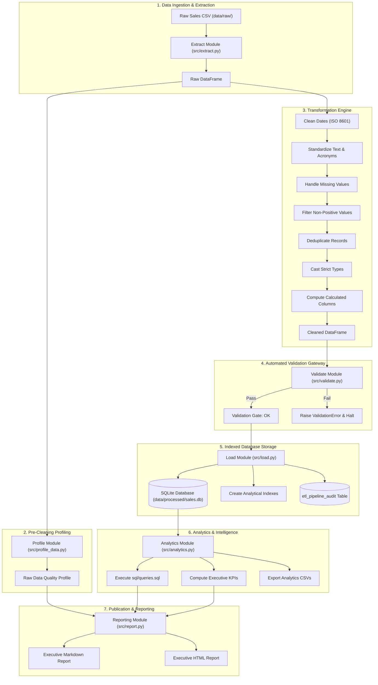

# 02. Architecture & Design Specification

## System Architecture

The Sales ETL Pipeline is structured around a sequential, modular architecture designed for high maintainability, deterministic data lineage, and fail-safe execution.

---

## Component Deep Dive

### 1. Configuration (`src/config.py`)
* **Role:** Single source of truth for filesystem paths, database URIs, column schemas, and validation parameters.
* **Path Resolution:** Dynamically anchors to `PROJECT_ROOT` using `Path(__file__).resolve().parent.parent` so execution works seamlessly from any working directory.
* **Customization:** Accepts custom file locations and database connection strings via `PipelineConfig`.

### 2. Extract (`src/extract.py`)
* **Role:** Ingests raw CSV data into memory while defending against common file read anomalies.
* **Capabilities:**
  * Multi-encoding detection and fallback (`utf-8`, `utf-8-sig`, `latin-1`, `cp1252`).
  * Header and required column presence verification before processing.
  * Batch concatenation support via `extract_multiple()` using glob patterns.

### 3. Profile (`src/profile_data.py`)
* **Role:** Collects empirical quality metrics on datasets to quantify data hygiene before and after transformations.
* **Telemetry Collected:** Row counts, column types, null counts, null percentages, duplicate rows, duplicate order IDs, negative/zero quantity counts, and numerical min/max/mean/median.
* **Auditing:** `compare_profiles()` calculates the exact net difference in dirty rows and data retention percentages.

### 4. Transform (`src/transform.py`)
* **Role:** Applies domain-driven cleaning rules sequentially:
  1. `clean_dates`: Standardizes heterogeneous date formats into standard datetime and filters corrupt entries.
  2. `standardize_text`: Strips trailing whitespace, converts names to title case, and restores uppercase domain acronyms (e.g., `USB Cable`). Supports modern Pandas 3.0+ string dtypes.
  3. `handle_missing_values`: Drops records missing essential attribution identifiers (`customer_id`, `quantity`, `unit_price`, `order_id`).
  4. `remove_invalid_rows`: Filters non-positive quantities (`quantity <= 0`) and prices (`unit_price <= 0`).
  5. `remove_duplicates`: Deduplicates exact duplicate records and ensures uniqueness across `order_id`.
  6. `cast_data_types`: Casts `quantity` to integer (`int64`) and `unit_price` to float (`float64`).
  7. `add_calculated_columns`: Computes `total_price`, `order_month`, `order_year`, `order_quarter`, and `day_of_week`.

### 5. Validate (`src/validate.py`)
* **Role:** Quality gateway asserting 8 strict invariant conditions prior to database loading:
  1. Non-empty dataset assertion.
  2. Complete required schema presence.
  3. Zero null values in mandatory fields.
  4. Strictly positive quantities.
  5. Strictly positive unit prices.
  6. Mathematical parity between `total_price` and `quantity * unit_price` (using floating-point tolerance).
  7. Absolute uniqueness of transaction identifiers (`order_id`).
  8. Customer ID format alignment against `^CUST\d{3}$`.

### 6. Load (`src/load.py`)
* **Role:** Persists clean datasets into the analytical warehouse and creates operational telemetry.
* **Optimization:** Automatically provisions B-tree indexes on high-frequency query columns (`order_date`, `customer_id`, `product_name`, `region`).
* **Lineage & Audit:** Records an entry in `etl_pipeline_audit` detailing execution run ID, timestamp, rows ingested, rows loaded, rows dropped, execution duration, and status.

### 7. Analytics (`src/analytics.py`)
* **Role:** Executes analytical SQL scripts (`sql/queries.sql`) against the SQLite database.
* **Features:**
  * Parses query statements and query titles from SQL file comments.
  * Calculates high-level executive KPIs (Total Revenue, Total Orders, Active Customers, Total Units Sold, Average Order Value, Top Product, Top Region).
  * Automatically exports query result sets to CSV files in `data/processed/analytics_exports/`.

### 8. Report (`src/report.py`)
* **Role:** Synthesizes pipeline telemetry, data quality metrics, and analytical findings into executive-ready reports.
* **Outputs:** Generates both a GitHub-Flavored Markdown report (`reports/pipeline_execution_report.md`) and a self-contained responsive HTML report (`reports/pipeline_execution_report.html`).

### 9. Orchestrator (`src/main.py`)
* **Role:** Coordinates the complete pipeline lifecycle, providing a unified CLI interface with timing telemetry, configurable logging, and exit code management.

---

## Technology Selection & Design Decisions

| Technology | Rationale | Alternatives Considered |
| :--- | :--- | :--- |
| **Python 3.10+ / 3.14** | Ubiquitous data engineering standard with native typing, extensive data ecosystem, and high performance. | Java, Go |
| **Pandas** | High-performance vectorized DataFrame manipulation, mixed date parsing, and intuitive transformation API. | Polars, PySpark |
| **SQLite + SQLAlchemy** | Zero external daemon configuration; self-contained file database; seamless transition to PostgreSQL or Snowflake via SQLAlchemy connection strings. | DuckDB, PostgreSQL |
| **Pytest** | Industry-standard test runner with clean fixtures, parametrized tests, and seamless CI/CD integration. | unittest |
